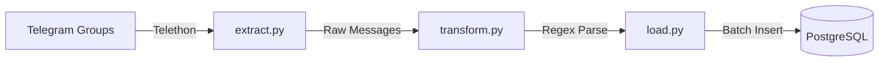

# ABA Transaction ETL

Pull ABA bank transaction notifications from Telegram into PostgreSQL.


## Features

- **Multi-shop** — Monitor any number of Telegram groups. Configured via a single env var.
- **Auto-parsing** — Extracts currency, amount, customer name, sender bank, and remark from ABA SMS notifications using regex.
- **Bank code resolution** — Maps raw KHQR bank codes (`PPCBKHPP`) to full bank names (`ABA BANK`) via a built-in lookup table.
- **Multi-currency** — Tracks USD and KHR. USD amounts are auto-converted to KHR-equivalent at 1 USD = 4,000 KHR.
- **Auto-ranging** — Remembers the last transaction date and suggests the next range automatically.
- **Resilient loading** — Batch-inserts into PostgreSQL; falls back row-by-row if a batch fails.
- **Web dashboard** — Read-only FastAPI + Chart.js overview with shop/date filters and KHR movement (DoD / MoM / YoY).

## Installation

### Docker (recommended)

```bash
docker compose up -d
```

This starts PostgreSQL and pgAdmin.

### Manual

```bash
uv sync
```

Requires Python 3.12+ and PostgreSQL running locally.

## Quick start

Create a `.env` file:

```env
API_ID=123456
API_HASH=your_api_hash
SHOPS=Mom:123456789,Dad:987654321
```

Then run the ETL:

```bash
docker compose run etl
```

You'll be prompted for a date range on the first run. After that, the tool auto-detects it.

## Usage

### Run the ETL

```bash
# With Docker
docker compose run etl

# Without Docker
uv run python main.py
```

**First run** — enter a date range manually:

```
No previous data found. Please provide a manual date range.
Start date (YYYY-MM-DD): 2024-06-01
End date (YYYY-MM-DD):   2024-12-31
```

**Subsequent runs** — the tool suggests the range automatically:

```
Extract from 2025-01-01 to 2025-06-09? (y/n):
```

Type `y` to accept or `n` to enter dates manually.

### View your data

| Service | URL | Login |
|---------|-----|-------|
| pgAdmin | http://localhost:5050 | `admin@admin.com` / `admin` |
| Web dashboard | http://localhost:8000 | none |

### Web dashboard

```bash
uv run uvicorn web.app:app
```

Open http://localhost:8000. It is read-only — it only displays data already
loaded by the ETL. Use the Shop and Date filters to narrow any chart.

## Configuration

### Environment variables

| Variable | Required | Description |
|----------|----------|-------------|
| `API_ID` | Yes | Telegram app ID from [my.telegram.org](https://my.telegram.org) |
| `API_HASH` | Yes | Telegram app hash from [my.telegram.org](https://my.telegram.org) |
| `SHOPS` | Yes | Comma-separated `name:id` pairs, e.g. `Mom:123,Dad:456` |
| `DB_HOST` | No | PostgreSQL host (default: `localhost`; Docker: `db`) |
| `DB_PORT` | No | PostgreSQL port (default: `5432`) |
| `DB_NAME` | No | PostgreSQL database name (default: `transactions`) |
| `DB_USER` | No | PostgreSQL user (default: `postgres`) |
| `DB_PASSWORD` | No | PostgreSQL password |
| `DATABASE_URL` | No | Full SQLAlchemy URI; overrides individual `DB_*` variables |

### Docker defaults

When running with Docker Compose, the `db` service uses these defaults:

| Variable | Default |
|----------|---------|
| `DB_HOST` | `db` (container hostname) |
| `DB_USER` | `postgres` |
| `DB_PASSWORD` | `postgres` |
| `DB_NAME` | `transactions` |

You only need to set `API_ID`, `API_HASH`, and `SHOPS` in `.env` — Docker handles the rest.

## How it works



1. **Extract** — `src/extract.py` fetches messages from every configured Telegram group via Telethon. Pauses 1s every 100 messages per group to avoid rate limits.

2. **Transform** — `src/transform.py` parses each ABA notification with regex to extract currency (`៛`/`$`), amount, customer name, sender bank, and remark. Bank codes are resolved against `src/data/bank_swift_code.csv`.

3. **Load** — `src/load.py` bulk-inserts into PostgreSQL. If a batch fails, it retries row-by-row to isolate the bad record. The `transactions` table is auto-created if it doesn't exist.

### Database schema

| Column | Type | Description |
|--------|------|-------------|
| `id` | `SERIAL` | Primary key |
| `currency` | `VARCHAR(3)` | `USD` or `KHR` |
| `amount` | `BIGINT` | Transaction amount |
| `customer_name` | `VARCHAR` | Payer name from the SMS |
| `date_of_transaction` | `TIMESTAMP` | When the transaction occurred |
| `sender_bank` | `VARCHAR` | Resolved bank name |
| `remark` | `VARCHAR` | Optional remark text |
| `shop_name` | `VARCHAR` | Shop group name (e.g. `Mom`) |
| `formatted_amount` | `BIGINT` | KHR-equivalent (USD × 4000) |

## Troubleshooting

### "No previous transactions found in DB"

First run — enter a date range when prompted:

```
Start date (YYYY-MM-DD): 2024-01-01
End date (YYYY-MM-DD):   2024-12-31
```

### Database connection fails

- **Docker** — Check the `db` container: `docker compose ps`
- **Manual** — Verify PostgreSQL is running and `.env` matches your database

### No messages returned

- Confirm group IDs in `SHOPS` are numeric Telegram group/supergroup IDs
- Expand the date range to verify groups are accessible

### Telegram authentication

On first run, Telethon prompts for your phone number and the verification code from Telegram. The session is saved to `session.session` — you won't be asked again unless that file is deleted.

## Project structure

```
├── main.py                    # CLI entry point
├── src/
│   ├── extract.py             # Telegram message fetching
│   ├── transform.py           # ABA SMS regex parser
│   ├── load.py                # PostgreSQL batch insert
│   ├── models/transaction.py  # SQLAlchemy ORM model
│   ├── services/etl.py        # Pipeline orchestrator
│   └── utils/
│       ├── db.py              # psycopg2 connection
│       ├── database.py        # SQLAlchemy engine
│       ├── get_last_date.py   # Auto-range detection
│       ├── map_bank_name.py   # Bank code lookup
│       └── telegram_config.py # Credentials + timezone
├── docker-compose.yml         # All services
├── Dockerfile                 # ETL container
└── web/                       # FastAPI dashboard
    ├── app.py                 # Routes
    ├── queries.py             # Read-only SQL aggregates
    └── static/                # index.html, app.js, style.css
```
